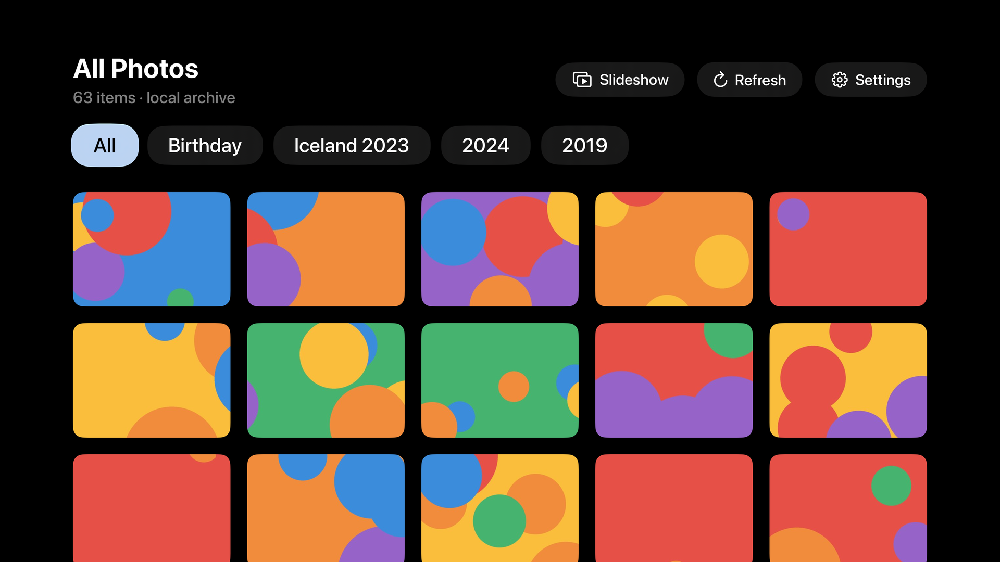
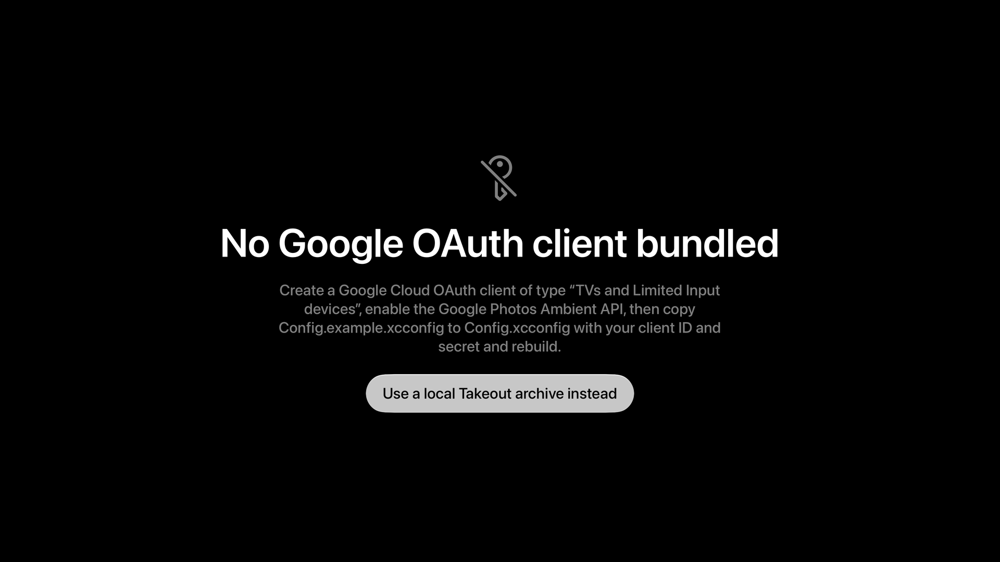

# GPhotos TV

An Apple TV (tvOS) app for browsing your Google Photos on the big screen — grid
browsing, a full-screen viewer, and an ambient slideshow, all driven from the
Siri Remote.



---

## Read this first: what Google actually allows

On **31 March 2025 Google removed full-library read access** from the Photos
API. The `photoslibrary.readonly`, `photoslibrary.sharing` and `photoslibrary`
scopes were discontinued and now return `403 PERMISSION_DENIED`
([announcement](https://developers.google.com/photos/support/updates)).

**No third-party app can enumerate your entire Google Photos library through the
API any more.** Any project claiming otherwise is either using a pre-2025
grandfathered client or reading an export.

This app therefore offers two sources, switchable in Settings:

| | **Ambient API** | **Takeout archive** |
|---|---|---|
| Coverage | Albums/people you assign to the TV | **Everything** |
| Freshness | Live | Snapshot, re-export to refresh |
| Setup | Scan a QR code on your phone | Export + run a local server |
| Quota | 240 API calls/device/day | None |
| Albums | Your chosen media sources | Full album + year structure |
| Needs a Mac running | No | Yes, on the same network |

Use the Ambient API for everyday viewing; use Takeout when you genuinely need
the whole library.

---

## Features

- **No typing on the remote.** Sign-in uses OAuth 2.0 for TV and Limited-Input
  Devices — the TV shows a QR code and a short code, you approve on your phone.
- **Grid browser** with collection filters, lazy paging and focus-driven
  prefetching.
- **Full-screen viewer** — left/right to page, metadata overlay that auto-hides,
  video playback via AVKit with authenticated streaming.
- **Ambient slideshow** with a slow Ken Burns drift; videos are skipped.
- **Aggressive caching.** Memory + disk cache for every thumbnail size, which
  matters because the Ambient API allows only 240 requests per device per day
  and Google's signed URLs expire after an hour.
- **Quota awareness.** Remaining daily calls are shown in the header, and the
  app stops short of the hard limit so an interactive refresh never 429s.

---

## Quick start

### Requirements

- macOS with **Xcode 16 or newer** (built against the tvOS 27 SDK)
- An Apple TV (4th gen or later) — or just the tvOS simulator
- [XcodeGen](https://github.com/yonaskolb/XcodeGen) only if you want to
  regenerate the project: `brew install xcodegen`

### 1. Clone and open

```bash
git clone https://github.com/<you>/gphotos.git
cd gphotos
open GPhotosTV.xcodeproj
```

The project builds and runs immediately. Without Google credentials it shows a
setup screen and offers the Takeout mode.



### 2. (Optional) Enable the live Google Photos mode

1. Create a project in the [Google Cloud Console](https://console.cloud.google.com/).
2. Enable the **Photos Ambient API**.
3. On the OAuth consent screen, add your own Google account as a **Test user**
   (a personal-use app never needs Google's verification review).
4. Create an OAuth **Client ID** of type **TVs and Limited Input devices**.
5. Copy the template and fill in your credentials:

   ```bash
   cp Config.example.xcconfig Config.local.xcconfig
   ```

   `Config.local.xcconfig` is git-ignored, so your client secret stays local.

6. Build and run. The TV shows a QR code → sign in on your phone → a second QR
   code opens Google Photos so you can choose **which albums, people and
   memories this TV may display**. Pick everything you want to browse.

### 3. (Optional) Browse your complete library via Takeout

1. Export your library at [takeout.google.com](https://takeout.google.com/)
   (select *Google Photos*), then unzip it.
2. Run the indexing server on your Mac:

   ```bash
   pip3 install Pillow
   python3 tools/takeout-server/server.py --root ~/Downloads/Takeout
   ```

   It prints a LAN address, for example `http://192.168.1.20:8099`.
3. On the Apple TV: **Settings → Takeout archive server**, enter that address,
   then switch the source to **Local Takeout Archive**.

The server reads Takeout's JSON sidecars for true capture dates, rebuilds your
album and year structure, generates cached thumbnails, and streams video with
HTTP range support so seeking works.

---

## Deploying to a real Apple TV

1. Put the Apple TV and the Mac on the **same network**.
2. On the Apple TV: **Settings → Remotes and Devices → Remote App and Devices**.
   Leave that screen open — it listens for pairing.
3. In Xcode: **Window → Devices and Simulators**, select the Apple TV, and enter
   the 6-digit code it displays.
4. Set a signing team: select the `GPhotosTV` target → **Signing & Capabilities**
   → pick your team. A free Apple ID works; builds then expire after 7 days.
5. Choose the Apple TV as the run destination and press ⌘R.

From the command line, once paired:

```bash
xcodebuild -project GPhotosTV.xcodeproj -scheme GPhotosTV \
  -destination 'platform=tvOS,name=<Your Apple TV>' \
  -allowProvisioningUpdates build
```

---

## Project layout

```
GPhotosTV/
  App/        App entry, AppState (phase machine), LibraryStore (paging)
  Auth/       Device-code OAuth flow, Keychain token storage
  Sources/    PhotoSource protocol + Ambient and Takeout implementations
  Media/      Authenticated image pipeline, two-tier cache
  Views/      SwiftUI screens
tools/
  make_assets.py        Regenerates the layered tvOS app icon
  takeout-server/       Local Takeout indexer and HTTP server
```

Both backends implement one `PhotoSource` protocol, so every screen is agnostic
about where photos come from.

### Regenerating the Xcode project

`project.yml` is the source of truth; `GPhotosTV.xcodeproj` is committed so the
repo works without extra tooling.

```bash
xcodegen generate
```

---

## Known limitations

- The Ambient API returns a **curated** feed, and Google automatically filters
  out screenshots, low-quality images and content it deems unsuitable for a
  shared display. Expect fewer items than the album holds.
- Ambient `baseUrl`s expire after 60 minutes; the app refetches a page when it
  detects stale URLs, which costs quota.
- Takeout mode is a point-in-time snapshot — re-export to pick up new photos.
- HEIC thumbnails need a Pillow build with HEIF support; without it the server
  falls back to sending the original file.

## Licence

[MIT](LICENSE)
